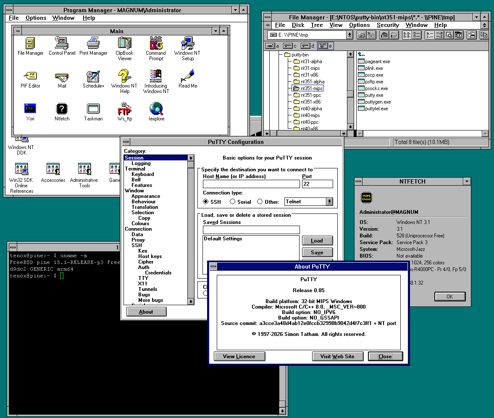

# PuTTY NT

[PuTTY](https://www.chiark.greenend.org.uk/~sgtatham/putty/) 0.85, the SSH and Telnet client, for Windows NT 3.1, 3.51 and 4.0 on Intel x86, MIPS, Alpha and PowerPC.

Upstream PuTTY needs CMake, a C99 compiler and a newer Windows. This port is C89 with one nmake Makefile. It builds with the original NT compilers of 1993 to 1996 and runs on the first versions of Windows NT.

## Download

Get the zip for your NT version and CPU from [Releases](https://github.com/tenox7/puttyNT/releases). Each zip has all eight programs: PuTTY, PuTTYtel, Plink, PSCP, PSFTP, PSOCKS, Pageant and PuTTYgen.

| | x86 | MIPS | Alpha | PowerPC |
|---|---|---|---|---|
| NT 3.1 | `nt31-x86` | `nt31-mips` | `nt31-alpha` | |
| NT 3.51 | `nt351-x86` | `nt351-mips` | `nt351-alpha` | `nt351-ppc` |
| NT 4.0 | `nt40-x86` | `nt40-mips` | `nt40-alpha` | `nt40-ppc` |

NT 3.1 has no PowerPC version. Each set was built on its own NT version and CPU, and tested there, in emulators.

## Differences from upstream PuTTY

- No Kerberos (GSSAPI), no IPv6 and no help file. NT 3.x and 4.0 don't have them.
- Bignum arithmetic uses 16-bit words, because the compilers of 1993 have no 64-bit integer type. So key exchange and key generation are slower.
- On MIPS, only six files are optimised: the big-number, key exchange and key file code (`crypto/mpint.c`, `ecc-arithmetic.c`, `ntru.c`, `mlkem.c`, `argon2.c` and `blake2.c`). Both MIPS compilers (NT 3.1 SDK and Visual C++ 4.x) make wrong code for some other functions when they optimise, the AES S-box among them. So the MIPS programs are bigger and slower than the others.
- Both MIPS compilers also lose the cast in `(unsigned short)(-x)` and `(unsigned short)(~x)`. `crypto/mpint.c` and `crypto/mpint_i.h` work around it.
- The WinSock of Windows NT 3.1 sometimes doesn't report network events, such as the server's first data after a slow connect. A login could then wait for ever. So the programs also check their connections with `select()` every 200 ms. And once `recv()` on a connection has failed with WSAEWOULDBLOCK, that WinSock gives the connection no more data, so the programs call `recv()` only when data is waiting.
- Windows NT 3.1 has no text for WinSock errors, so the programs have their own. NT 3.1 also gives the same error for every name it can't look up, so "Host not found" can also mean that TCP/IP is set to use the hosts file only.
- Windows NT draws Unicode text in a bitmap font as if the font were in code page 1252, whatever the font's own code page. So with the Terminal font, whose code page is the OEM one (437 in the US), PuTTY changes the text to that code page itself. Box drawing, block and accented characters then show right. A character that the code page lacks becomes a similar one, or `?`.

## Build

Open a command prompt set up for your compiler, go to the source folder and run nmake:

| NT | Compiler | Command |
|---|---|---|
| 3.1 | Win32 SDK for Windows NT 3.1 (cl386, mcl, claxp) | `nmake` |
| 3.51 | Visual C++ 4.x | `nmake APPVER=3.51` |
| 4.0 | Visual C++ 4.x | `nmake` |

The `CPU` environment variable (`i386`, `MIPS`, `ALPHA` or `PPC`) picks the processor. `nmake clean` deletes what nmake made. Visual C++ 2.0 builds it too.

## Testing

- PuTTY's own crypto tests (testcrypt): 222,037 tests recorded on x86, then run with each of the 7 compilers. All results match. (A few BLAKE2b answers differ only in buffer bytes that the test reads without filling.)
- Pageant unlocks a passphrase-protected Ed25519 key on all 11 builds (tested with v0.85).
- SSH: on all 11 builds, Plink, PSCP and PSFTP log in to OpenSSH 10.3 and copy a file both ways, with SFTP and SCP. The files arrive unchanged.
- NT 3.1 MIPS: 40 Plink logins and 4 PuTTY logins in a row, and none hung. Before the WinSock fix, 2 of 7 Plink logins hung.
- NT 3.1 MIPS, PuTTY over Telnet: all 45 KB from mapscii.me arrived, and PuTTY saw at once that the server closed the connection. ASCII Star Wars from towel.blinkenlights.nl ran for over 500 KB without a stop. v0.85-1 stopped reading part way.
- Terminal font, UTF-8 text over SSH: box drawing, block, accented, Greek and math characters show right on NT 3.1 MIPS, NT 3.51 x86 and NT 4.0 x86, and MapSCII draws its map. v0.85-1 showed them as blanks or other characters.

## Source

The layout is the same as upstream PuTTY, without the Unix port, CMake, the documentation and the tests. The git history starts with the PuTTY 0.85 source zip as released. The next commit removes what NT doesn't use, and the one after it is the port. So every change can be seen.

## License

MIT, the same as PuTTY. See [LICENCE](LICENCE).
